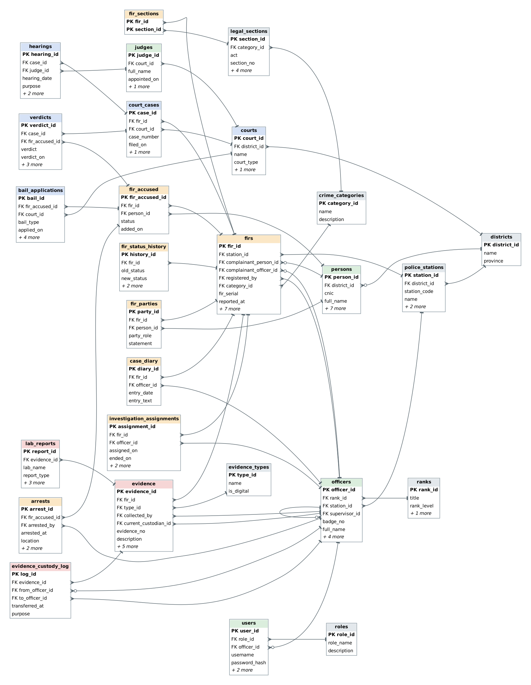

# Entity Relationship Diagram

The picture above is [`erd.svg`](erd.svg) (scalable) and [`erd.png`](erd.png). The same model as a Mermaid diagram follows; GitHub draws it in the browser.

Colours in the picture: grey is reference data, green is people, orange is the FIR and its investigation, red is evidence, blue is courts.

```mermaid
erDiagram
    fir_accused ||--o{ arrests : "fir_accused_id"
    officers ||--o{ arrests : "arrested_by"
    fir_accused ||--o{ bail_applications : "fir_accused_id"
    courts ||--o{ bail_applications : "court_id"
    firs ||--o{ case_diary : "fir_id"
    officers ||--o{ case_diary : "officer_id"
    courts ||--o{ court_cases : "court_id"
    firs ||--o{ court_cases : "fir_id"
    districts ||--o{ courts : "district_id"
    officers ||--o{ evidence : "collected_by"
    officers ||--o{ evidence : "current_custodian_id"
    firs ||--o{ evidence : "fir_id"
    evidence_types ||--o{ evidence : "type_id"
    evidence ||--o{ evidence_custody_log : "evidence_id"
    officers |o--o{ evidence_custody_log : "from_officer_id"
    officers ||--o{ evidence_custody_log : "to_officer_id"
    firs ||--o{ fir_accused : "fir_id"
    persons ||--o{ fir_accused : "person_id"
    firs ||--o{ fir_parties : "fir_id"
    persons ||--o{ fir_parties : "person_id"
    firs ||--o{ fir_sections : "fir_id"
    legal_sections ||--o{ fir_sections : "section_id"
    firs ||--o{ fir_status_history : "fir_id"
    crime_categories ||--o{ firs : "category_id"
    officers |o--o{ firs : "complainant_officer_id"
    persons |o--o{ firs : "complainant_person_id"
    officers ||--o{ firs : "registered_by"
    police_stations ||--o{ firs : "station_id"
    court_cases ||--o{ hearings : "case_id"
    judges ||--o{ hearings : "judge_id"
    firs ||--o{ investigation_assignments : "fir_id"
    officers ||--o{ investigation_assignments : "officer_id"
    courts ||--o{ judges : "court_id"
    evidence ||--o{ lab_reports : "evidence_id"
    crime_categories ||--o{ legal_sections : "category_id"
    ranks ||--o{ officers : "rank_id"
    police_stations ||--o{ officers : "station_id"
    officers |o--o{ officers : "supervisor_id"
    districts |o--o{ persons : "district_id"
    districts ||--o{ police_stations : "district_id"
    officers |o--o{ users : "officer_id"
    roles ||--o{ users : "role_id"
    fir_accused ||--o{ verdicts : "fir_accused_id"
    court_cases ||--o{ verdicts : "case_id"
    arrests {
        int arrest_id PK
        int fir_accused_id FK
        smallint arrested_by FK
        datetime arrested_at
        varchar location
        tinyint remand_days
        datetime released_at
    }
    bail_applications {
        int bail_id PK
        int fir_accused_id FK
        smallint court_id FK
        enum bail_type
        date applied_on
        date decided_on
        enum decision
        decimal surety_amount
        varchar remarks
    }
    case_diary {
        int diary_id PK
        int fir_id FK
        smallint officer_id FK
        date entry_date
        text entry_text
    }
    court_cases {
        int case_id PK
        varchar case_number
        int fir_id FK
        smallint court_id FK
        date filed_on
        enum status
    }
    courts {
        smallint court_id PK
        varchar name
        enum court_type
        tinyint district_id FK
        varchar address
    }
    crime_categories {
        tinyint category_id PK
        varchar name
        varchar description
    }
    districts {
        tinyint district_id PK
        varchar name
        varchar province
    }
    evidence {
        int evidence_id PK
        varchar evidence_no
        int fir_id FK
        tinyint type_id FK
        varchar description
        smallint collected_by FK
        datetime collected_at
        varchar found_location
        smallint current_custodian_id FK
        varchar storage_location
        enum status
        char hash_sha256
    }
    evidence_custody_log {
        bigint log_id PK
        int evidence_id FK
        smallint from_officer_id FK
        smallint to_officer_id FK
        datetime transferred_at
        varchar purpose
    }
    evidence_types {
        tinyint type_id PK
        varchar name
        tinyint is_digital
    }
    fir_accused {
        int fir_accused_id PK
        int fir_id FK
        int person_id FK
        enum status
        date added_on
    }
    fir_parties {
        int party_id PK
        int fir_id FK
        int person_id FK
        enum party_role
        text statement
    }
    fir_sections {
        int fir_id PK,FK
        smallint section_id PK,FK
    }
    fir_status_history {
        bigint history_id PK
        int fir_id FK
        varchar old_status
        varchar new_status
        datetime changed_at
        varchar changed_by
    }
    firs {
        int fir_id PK
        smallint station_id FK
        smallint fir_serial
        datetime reported_at
        smallint fir_year
        int complainant_person_id FK
        smallint complainant_officer_id FK
        smallint registered_by FK
        datetime incident_at
        varchar incident_location
        tinyint category_id FK
        text description
        enum status
        varchar closure_remarks
        datetime created_at
    }
    hearings {
        int hearing_id PK
        int case_id FK
        date hearing_date
        smallint judge_id FK
        enum purpose
        varchar outcome
        date next_hearing_date
    }
    investigation_assignments {
        int assignment_id PK
        int fir_id FK
        smallint officer_id FK
        date assigned_on
        date ended_on
        varchar reason
        int active_fir_id
    }
    judges {
        smallint judge_id PK
        varchar full_name
        smallint court_id FK
        date appointed_on
        tinyint is_active
    }
    lab_reports {
        int report_id PK
        int evidence_id FK
        varchar lab_name
        enum report_type
        date submitted_on
        date reported_on
        text findings
    }
    legal_sections {
        smallint section_id PK
        varchar act
        varchar section_no
        varchar title
        tinyint category_id FK
        varchar punishment_summary
        tinyint is_cognizable
        tinyint is_bailable
    }
    officers {
        smallint officer_id PK
        varchar badge_no
        varchar full_name
        tinyint rank_id FK
        smallint station_id FK
        smallint supervisor_id FK
        varchar phone
        varchar email
        date joined_on
        tinyint is_active
    }
    persons {
        int person_id PK
        char cnic
        varchar full_name
        varchar father_name
        enum gender
        date date_of_birth
        varchar phone
        varchar address
        tinyint district_id FK
        varchar occupation
        datetime created_at
    }
    police_stations {
        smallint station_id PK
        char station_code
        varchar name
        tinyint district_id FK
        varchar address
        varchar phone
    }
    ranks {
        tinyint rank_id PK
        varchar title
        tinyint rank_level
        tinyint can_investigate
    }
    roles {
        tinyint role_id PK
        varchar role_name
        varchar description
    }
    users {
        smallint user_id PK
        varchar username
        char password_hash
        tinyint role_id FK
        smallint officer_id FK
        tinyint is_active
        datetime created_at
    }
    verdicts {
        int verdict_id PK
        int case_id FK
        int fir_accused_id FK
        enum verdict
        date verdict_on
        decimal sentence_years
        decimal fine_amount
        varchar remarks
    }
```

