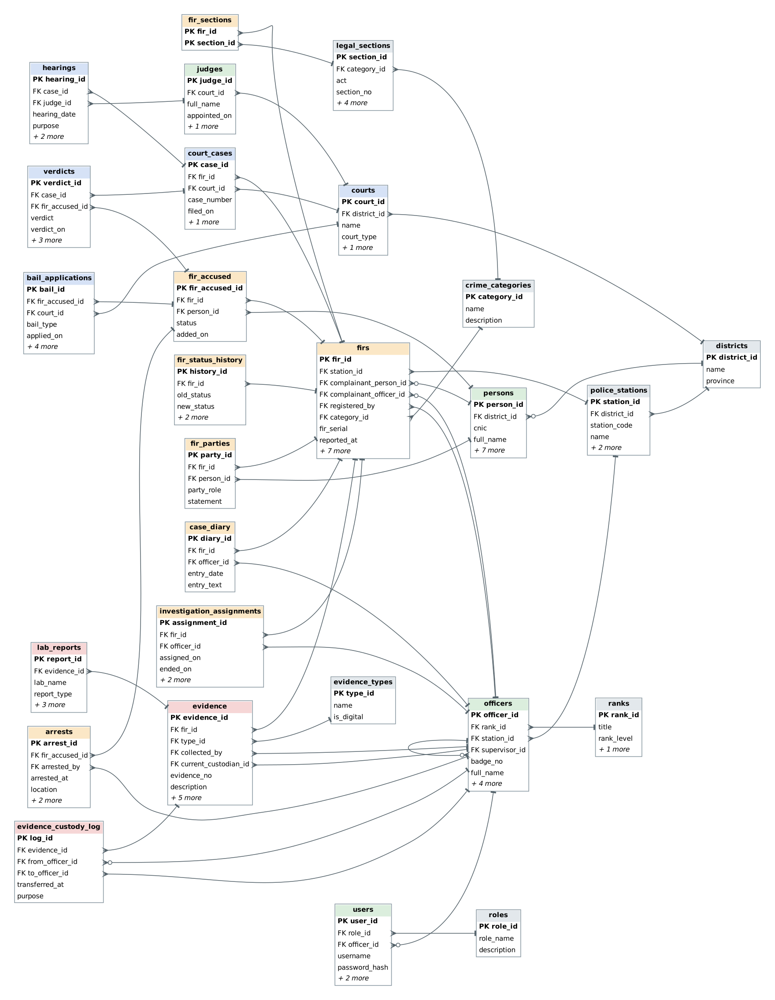

# FIR and Criminal Case Management System

**Project report**

| | |
|---|---|
| **Project** | FIR and Criminal Case Management System |
| **Field** | Criminology and Criminal Justice |
| **Course** | Database Management Systems |
| **Student(s)** | _add names here_ |
| **Instructor** | _add name here_ |
| **DBMS** | MySQL 8.0 |

---

## Abstract

Police records of crime are often kept in registers and files. They are hard to search, hard to keep consistent and easy to lose. This project designs and builds a relational database in MySQL 8.0 that follows a criminal case from the First Information Report (FIR) at a police station to the verdict of a court. The database has 27 tables in third normal form, 23 triggers, 13 stored procedures, 3 functions and 8 views. The rules of the process are written into the database itself: an FIR cannot be deleted, a case cannot reach court before it is investigated, the complainant cannot be the accused, digital evidence cannot be stored without a tamper-proof hash, and every hand-over of an exhibit is logged automatically. The database is filled with a fictional but realistic data set of 24 FIRs that is replayed through the stored procedures. 27 report queries and 45 integrity tests show that the database answers real questions and refuses invalid data. All 45 tests pass.

---

## 1. Introduction

### 1.1 Background

A criminal case passes through several hands. A complainant reports an incident, a police station registers an FIR, an investigating officer collects evidence and arrests suspects, a forensic laboratory examines exhibits, and a court hears the case, decides bail and gives a verdict. Each step produces records. When these records live in separate paper registers, a simple question such as "which cases are waiting for an investigating officer?" or "who held this weapon between the laboratory and the court?" takes hours or cannot be answered.

### 1.2 Problem statement

Traditional record-keeping systems often involve manual paperwork, which can make it difficult to search, update, maintain and analyze criminal records. The same person appears with different spellings, the history of an exhibit is not written down, the age of an investigation is not visible, and nobody can easily see how many cases a station closed or how many accused are absconding.

### 1.3 Objectives

1. Design one centralized database for FIRs, persons, officers, investigations, evidence, courts, bail and verdicts.
2. Store every fact once (third normal form) and connect records with keys.
3. Enforce the rules of criminal procedure inside the database, so that no program can break them.
4. Provide ready-made reports for station heads, investigating officers and court staff.
5. Show with queries and tests that the database works.

### 1.4 Scope

The project covers the database only: schema, constraints, triggers, procedures, views, sample data, queries, tests and documents. It does not include a user interface, biometric data or real personal data. See [REQUIREMENTS.md](REQUIREMENTS.md).

---

## 2. Requirements

The full list is in [REQUIREMENTS.md](REQUIREMENTS.md): 48 functional requirements, 14 business rules and 9 non-functional requirements, each traced to the table, trigger, procedure or view that implements it. In short, the database must:

- register FIRs with a number that is unique per station and year, one or more sections of law, and a complainant who is either a person or the State;
- keep one record per person and show their history across cases;
- assign investigating officers (one at a time, with history) and keep a case diary;
- record arrests, evidence, chain of custody and laboratory reports;
- follow the case into court: challan, case, hearings, bail and verdicts;
- report on workload, delays, outcomes and the court calendar.

---

## 3. Methodology

| Step | What was done | Result |
|---|---|---|
| 1 | Studied the process of an FIR from registration to verdict and listed the people, documents and decisions in it | Entity list, section 4.1 |
| 2 | Drew the entity relationship diagram and decided cardinalities | [ERD.md](ERD.md) |
| 3 | Started from one flat sheet of an FIR and normalized it step by step | Section 5 |
| 4 | Wrote the schema with keys and constraints | `database/schema.sql` |
| 5 | Moved the rules of the process into triggers, procedures and views | `database/logic.sql` |
| 6 | Built a sample data set by replaying 24 FIRs through the procedures | `database/data.sql` |
| 7 | Wrote 27 report queries and 45 rule-breaking tests, then ran them | `database/queries.sql`, `database/integrity_tests.sql` |
| 8 | Generated the data dictionary, ERD and result documents from the live database | `tools/build_docs.py` |

All files were developed and tested on MySQL 8.0.46.

---

## 4. Conceptual design

### 4.1 Identifying the entities

| Group | Entities |
|---|---|
| Places and law | district, police station, court, crime category, legal section |
| People | person (complainant, victim, witness, accused), police officer, rank, judge, system user and role |
| FIR | FIR, FIR sections, accused, victims and witnesses, status history |
| Investigation | investigation assignment, case diary, arrest |
| Evidence | evidence type, evidence, custody log, lab report |
| Court | court case, hearing, bail application, verdict |

### 4.2 Relationships and cardinality

| Relationship | Cardinality | Notes |
|---|---|---|
| District has police stations, courts | 1 : N | |
| Police station registers FIRs | 1 : N | FIR number is unique per station and year |
| Police station posts officers | 1 : N | |
| Officer supervises officers | 1 : N (self) | Used by the recursive query Q23 |
| FIR is charged under sections | M : N | `fir_sections` |
| FIR has accused persons, victims and witnesses | M : N between FIR and person | `fir_accused`, `fir_parties` |
| FIR is investigated by officers over time | 1 : N | Only one open assignment at a time |
| FIR has diary entries, evidence, case(s) | 1 : N | |
| Evidence has custody log entries, lab reports | 1 : N | |
| Accused has arrests, bail applications | 1 : N | |
| Court case has hearings and verdicts | 1 : N | A verdict belongs to one accused |
| Court has judges | 1 : N | A hearing's judge must sit in that court |

### 4.3 Entity relationship diagram



The diagram has 27 entities and 44 relationships. Every column, key and rule is in [DATA_DICTIONARY.md](DATA_DICTIONARY.md).

---

## 5. Logical design and normalization

### 5.1 Starting point: one flat sheet (UNF)

A paper FIR register line, copied into one table, looks like this:

| FIR no | Station | District | Complainant, father, CNIC | Accused (many) | Sections (many) | Officer, rank | Evidence (many) | Court, judge | Verdict |
|---|---|---|---|---|---|---|---|---|---|
| CNT-1/26 | Cantt Road | Rawalpindi | Naseer Ud Din, Fazal Ud Din, 00000-... | Gulzar Ahmed; Sher Zaman | 302 | Maryam Aslam, SI | axe; clothes; phone | Sessions Court, Rawalpindi, Ayesha Qazi | pending |

Problems: several values in one cell, the station and district repeated on every FIR of that station, the person's details repeated every time the person appears, and the officer's rank repeated on every case.

### 5.2 First normal form (1NF)

Every cell holds one value. Accused, sections and evidence are moved out into rows of their own (`fir_accused`, `fir_sections`, `evidence`). Each table gets a primary key.

### 5.3 Second normal form (2NF)

No column may depend on only part of a composite key. In `fir_sections(fir_id, section_id)` there are no other columns, so nothing partial can exist. The title, punishment and bail flags of a section depend only on `section_id`, so they live in `legal_sections` and not in the link table.

### 5.4 Third normal form (3NF)

No column may depend on another non-key column.

| Dependency found | Fix |
|---|---|
| FIR station name and district depend on the station, not on the FIR | `police_stations`, `districts` |
| Officer rank title and the right to investigate depend on the rank | `ranks` (with `can_investigate`) |
| Person's name, father and ID number depend on the person, not on the case | `persons`, referenced from every case table |
| Judge name depends on the judge; the court depends on the judge | `judges.court_id`, `courts` |
| Evidence type name and whether it is digital | `evidence_types` |

### 5.5 Deliberate design choices

- **One `persons` table for every role.** The same human can be complainant in one FIR, witness in another and accused in a third. Q24 finds exactly such a person. Separate tables for each role would hide this. The rules that stop one person holding conflicting roles in the same FIR are triggers.
- **The State as complainant.** In narcotics and arms cases the complainant is a police officer. `firs` has two nullable complainant columns and the CHECK `chk_firs_one_complainant` demands exactly one.
- **No stored totals.** FIR counts, conviction rates and days idle are computed by views and queries, so they can never drift from the data.
- **A generated column for "one active investigator".** `investigation_assignments.active_fir_id` equals `fir_id` while the assignment is open and `NULL` after it ends. A UNIQUE key on it allows many closed assignments but only one open one per FIR, with no trigger needed.
- **`fir_year` is a generated column** (`YEAR(reported_at)`), so the FIR number `RVS-0007/2026` cannot disagree with the reporting date.
- **Status as ENUM plus history table.** The current status is on the FIR for fast filtering. The history is in `fir_status_history`, written by a trigger.
- **Reference law data is illustrative.** The legal sections are sample reference rows, not legal advice.

---

## 6. Physical design

| Topic | Choice |
|---|---|
| Engine | InnoDB, for foreign keys and transactions |
| Character set | utf8mb4, so names in any script are stored correctly |
| Keys | Unsigned integer surrogate primary keys; natural keys (CNIC, badge number, evidence number, case number, section act and number) are UNIQUE |
| Sizing | TINYINT for the small lookup tables, SMALLINT for stations and officers, INT for FIRs and persons, BIGINT for the log tables that grow fastest |
| Money | `DECIMAL(12,2)` for fines and surety, never FLOAT |
| Times | `DATETIME` for events, `DATE` for dates without a time of day |
| Indexes | Every foreign key; `persons.full_name`; `firs.status`; `firs.reported_at`; composite indexes on (`fir_id`, `entry_date`), (`evidence_id`, `transferred_at`) and (`fir_id`, `changed_at`) |
| Referential actions | `RESTRICT` everywhere. A parent row with children cannot be deleted. History is never cascaded away |
| Constraints | 44 foreign keys, 25 CHECK, 24 UNIQUE, ENUM for fixed vocabularies |

MySQL allows no CHECK on an auto-increment column, so the rule "an officer cannot supervise themselves" is a trigger (`trg_officers_bu`), not a CHECK.

---

## 7. Implementation

### 7.1 One build script

`database/schema.sql`, `database/logic.sql` and `database/data.sql` are joined into `database/fir_ccms.sql`. `mysql < fir_ccms.sql` creates everything. The GitHub workflow does exactly this on a clean MySQL 8.0 server and then runs the tests.

### 7.2 Views

| View | Purpose |
|---|---|
| `vw_fir_register` | The FIR register: number, station, complainant, sections, status, investigator, reporting delay |
| `vw_open_cases_by_officer` | Open investigations per officer |
| `vw_crime_by_district_category` | Statistics by district and category |
| `vw_criminal_history` | Every FIR in which a person was accused and how it ended |
| `vw_evidence_custody_status` | Where every exhibit is and how often it moved |
| `vw_stale_investigations` | Investigations with no diary entry for 30 days |
| `vw_station_performance` | Workload and outcomes per station |
| `vw_cause_list` | Court calendar: next hearing of every open case, using `ROW_NUMBER()` |

### 7.3 Stored procedures and transactions

Ten write procedures each run in one transaction with an `EXIT HANDLER FOR SQLEXCEPTION` that rolls back and re-raises the error. Three read procedures return lookups.

| Procedure | What it does as one unit |
|---|---|
| `sp_register_fir` | Allocates the next serial for the station and year (`SELECT ... FOR UPDATE`), inserts the FIR, returns the new number |
| `sp_assign_investigator` | Closes the open assignment, opens a new one, moves a Registered FIR to Under Investigation |
| `sp_transfer_evidence` | Changes custodian and status; the trigger writes the custody log |
| `sp_register_arrest` | Inserts the arrest; the trigger sets the accused to Arrested |
| `sp_decide_bail` | Records the decision once; the trigger releases the accused when bail is granted |
| `sp_submit_challan` | Checks that there is an accused and moves the FIR to Challaned |
| `sp_file_court_case` | Inserts the case and moves the FIR to In Court |
| `sp_record_verdict` | Inserts the verdict; when every accused who can be tried has one, marks the case Decided and the FIR Closed |
| `sp_withdraw_case` | Withdraws the case, discharges the accused, closes the FIR with a reason |
| `sp_cancel_fir` | Ends the open assignment and cancels the FIR with a reason |
| `sp_fir_dossier`, `sp_person_profile`, `sp_officer_caseload` | Read-only: the whole case file, a person's history, an officer's files |

### 7.4 Triggers

The 23 triggers fall into five groups.

| Group | Triggers | Effect |
|---|---|---|
| FIR life cycle | `trg_firs_bi`, `trg_firs_ai`, `trg_firs_bu`, `trg_firs_au`, `trg_firs_bd` | Validates the registering officer, writes the status history, blocks illegal status changes, blocks deletion |
| People | `trg_fir_accused_bi`, `trg_fir_parties_bi`, `trg_officers_bu` | Complainant, witness and accused conflicts; self-supervision |
| Investigation | `trg_assign_bi`, `trg_diary_bi`, `trg_arrests_bi`, `trg_arrests_ai` | Rank and activity of the investigator, who may write the diary, arrest checks, accused status |
| Evidence | `trg_evidence_bi`, `trg_evidence_ai`, `trg_evidence_bu`, `trg_evidence_au` | Hash for digital evidence, immutability, custody log in time order |
| Court | `trg_bail_bi`, `trg_bail_au`, `trg_cases_bi`, `trg_hearings_bi`, `trg_hearings_ai`, `trg_verdicts_bi`, `trg_verdicts_ai` | Bail effects, case filing checks, hearing checks, status automation, verdict checks |

The chain of custody shows why triggers matter. Whatever program changes `evidence.current_custodian_id`, `trg_evidence_au` writes the log row. A clerk cannot move an exhibit without leaving a trace.

### 7.5 ACID in this project

| Property | Where it shows |
|---|---|
| **Atomicity** | `sp_record_verdict` inserts the verdict, decides the case and closes the FIR together, or none of it. Test T31 (a verdict for the wrong accused) is rolled back completely and leaves no partial change |
| **Consistency** | Foreign keys, CHECKs and triggers move the database only from one valid state to another. The test runner compares the row count of every table before and after the 45 tests and finds no change |
| **Isolation** | InnoDB row locks. `sp_register_fir` locks while it reads the highest serial; the unique key on station, year and serial is the final guard if two clerks register at once |
| **Durability** | InnoDB writes a redo log; committed work survives a crash |

### 7.6 Security

`database/roles_and_privileges.sql` creates six MySQL roles. Nobody gets write access to the central tables. Instead they get `EXECUTE` on the procedures, which run with the owner's rights and apply every rule. Verified with temporary accounts:

| Role | Direct rights | Procedures |
|---|---|---|
| `fir_auditor` | SELECT | `sp_fir_dossier`, `sp_person_profile` |
| `fir_clerk` | SELECT; insert persons, sections, parties | `sp_register_fir` |
| `fir_investigator` | SELECT; insert diary, accused, evidence, lab reports | arrest, evidence transfer, challan |
| `fir_sho` | investigator and clerk rights | plus `sp_assign_investigator`, `sp_cancel_fir` |
| `fir_court` | SELECT; insert hearings and bail applications | bail decision, filing, verdict, withdrawal |
| `fir_admin` | all privileges | all |

An auditor trying `UPDATE persons ...` gets error 1142 (denied). A station head trying `DELETE FROM firs ...` or a direct `UPDATE firs SET status='Closed'` also gets error 1142; the same station head can assign an investigator through the procedure. Passwords in the sample data are demo hashes only; a real system must use salted, slow hashing in the application.

### 7.7 Sample data

The 24 FIRs are described as timelines in `tools/generate_sample_data.py` and replayed through the real procedures on a simulated clock, `@as_of`. All logic reads the time through `fn_now()`, which returns `NOW()` unless `@as_of` is set. Because of this the triggers write true history: the custody log has 99 rows and the FIR status history 79 rows, none inserted by hand. The cases were chosen to cover the main paths:

| Path | Example |
|---|---|
| Registered, no officer yet | OLD-0003/2026 |
| Investigation gone quiet | SDB-0001/2026 (211 days) |
| Challan submitted, not yet in court | ARP-0001/2026 (cyber), ARP-0002/2026 (arms) |
| Trial in progress | CNT-0001/2026 (murder), CY-LHR-2026-0031 (cyber) |
| Conviction | RVS-0001/2026, UNI-0001/2026, CNT-0002/2026 |
| Mixed verdict (one convicted, one acquitted) | RVS-0003/2026 |
| Settled and withdrawn | OLD-0001/2026 |
| False report, cancelled | UNI-0002/2026 |
| Accused absconding | IND-0001/2026, OLD-0002/2026, CNV-0003/2026 |
| Repeat offender | Rehan Lakhani, Adnan Sheikh |
| Witness in one FIR, accused in another | Mubashir Ali |
| Investigation re-assigned to a senior officer | CNT-0001/2026 |

---

## 8. Testing and results

### 8.1 Functional tests: 27 queries

[QUERY_RESULTS.md](QUERY_RESULTS.md) contains each query, its purpose and its real output. Selected findings from the sample data:

- 24 FIRs: 8 in court, 5 under investigation, 5 closed, 3 just registered, 2 challaned, 1 cancelled (Q03).
- Industrial Area station has the longest average reporting delay, 337.5 hours, because both of its FIRs were reported about two weeks after the incident (Q12).
- Three investigations have been idle for more than 30 days; one for 211 days (Q20).
- Two persons are accused in more than one FIR (Q07). One person is a witness in one FIR and accused in another (Q24).
- Of the five verdicts, four are convictions. Offences against the person have a 50% conviction rate in the sample (Q14).
- Eight hearings are fixed in the next 60 days, the first on 3 November 2026 (Q15).

### 8.2 Integrity tests: 45 rule-breaking attempts

[INTEGRITY_TESTS.md](INTEGRITY_TESTS.md) lists each attempt with MySQL's own error message. Examples:

| Test | Attempt | MySQL's answer |
|---|---|---|
| T01 | `DELETE FROM firs WHERE fir_id = 1` | FIRs are permanent records and cannot be deleted |
| T07 | Make a witness the accused in the same FIR | already a victim or witness |
| T10 | A second open investigating officer | Duplicate entry for `uq_one_active_io` |
| T12 | Digital evidence without a hash | must be registered with its SHA-256 hash |
| T17 | Move destroyed evidence | cannot move again |
| T28 | A judge from another court in a hearing | does not sit in the court that holds this case |

All 45 are rejected and the row count of every table is identical before and after the run. The same run is performed by GitHub Actions on every push.

---

## 9. Discussion

**What worked well.** Putting the rules in the database made the application layer almost trivial: any future screen only calls procedures. The chain of custody is the best example, because the trigger makes the log impossible to skip. The generated-column trick for the single active investigator is short and needs no extra code.

**What was hard.** MySQL has some limits that shaped the design: no CHECK on an auto-increment column, no CHECK with a date function such as `CURDATE()`, and no CHECK that reads another table. Rules of those kinds (date of birth not in the future, the arrest after the incident) had to be triggers.

**Limits.**

- The legal reference data is illustrative. Real use needs the statutes loaded and reviewed by a lawyer.
- Time zones are not stored.
- Transfer of an FIR between stations and appeals to a higher court are not modelled.
- The database stores the hash of digital evidence but not the evidence file itself.

---

## 10. Conclusion and future work

The project delivers a complete, tested relational database for FIRs and criminal cases in MySQL. The data model follows a case from first report to verdict. The database enforces 14 business rules by itself, writes the history of FIR status and of every exhibit automatically, and answers 27 practical questions. All 45 integrity tests pass.

Future work: a web front end that only calls the stored procedures; row-level access by station; warrants and proclaimed offenders; appeals; prison records; hearing reminders by SMS; a map of crime by location.

---

## References

1. MySQL 8.0 Reference Manual: CREATE TABLE (CHECK constraints, generated columns), CREATE TRIGGER, CREATE PROCEDURE, window functions, WITH (common table expressions), roles. https://dev.mysql.com/doc/refman/8.0/en/
2. C. J. Date, *An Introduction to Database Systems*, Pearson.
3. R. Elmasri and S. Navathe, *Fundamentals of Database Systems*, Pearson.
4. Code of Criminal Procedure, 1898 (Pakistan), section 154 on the First Information Report, and the Pakistan Penal Code, 1860. Section data in this project is illustrative only.
5. Prevention of Electronic Crimes Act, 2016 (Pakistan).

---

## Appendix A: How to reproduce

```bash
mysql -u root -p < database/fir_ccms.sql               # build everything
mysql -u root -p fir_ccms < database/queries.sql       # run the 27 queries
python3 tools/run_integrity_tests.py                   # run the 45 tests
mysql -u root -p < database/roles_and_privileges.sql   # optional roles
python3 tools/build_docs.py                            # regenerate these documents
```

## Appendix B: Presentation outline (10 slides)

1. Title and problem: paper registers cannot answer questions
2. What the system covers: FIR to verdict
3. The ERD in six colours
4. Normalization: from one flat sheet to 27 tables
5. Rules inside the database: FIR cannot be deleted, one active investigator
6. Chain of custody: the axe in the murder case (Q09)
7. Procedures and transactions: register an FIR, record a verdict
8. Live demo: `sp_fir_dossier(7)` and a refused `DELETE`
9. Results: 27 queries, 45 of 45 tests pass
10. Limits and future work
